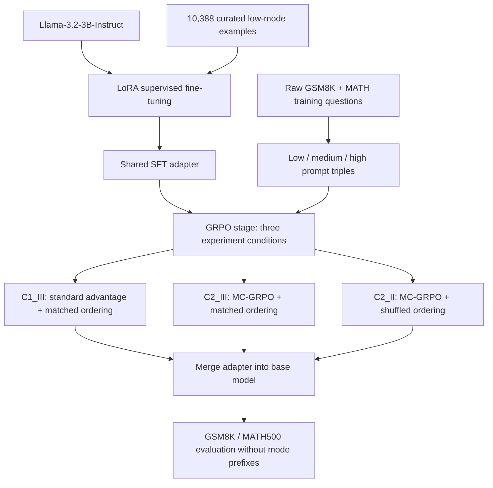

<div align="center">

# MC-GRPO

**Mode-Conditioned Advantage Normalization: A Length-Stratified Variant of GRPO for Multi-Mode Math Reasoning**

Multi-mode reasoning · Length-aware advantage scaling · Llama 3.2 3B

<p>
  
  
  
  
  
  
</p>

[Method](#how-mc-grpo-works) · [Training pipeline](#training-pipeline) · [Results](#evaluation-results) · [Getting started](#getting-started) · [Project report](report.pdf)

</div>

## Project overview

MC-GRPO explores a question in reinforcement learning for mathematical reasoning: **when a model learns several reasoning styles together, how can we reduce the extra weight given to modes that produce longer answers?**

The project trains **Llama-3.2-3B-Instruct** to respond at three reasoning depths: `low`, `medium`, and `high`. Under the token-level DAPO loss, longer completions contribute more token terms to an update. When reasoning modes have different average lengths, this creates a source of imbalance across modes.

MC-GRPO adjusts the standard group-relative advantage using each mode's mean completion length. It aims to remove the between-mode length effect while preserving length differences within each mode. Both the comparison condition and MC-GRPO use the DAPO loss.

This is an individual **COMP2050 Artificial Intelligence** project by **Tue-Anh Vu, VinUniversity**, extending the multi-mode reasoning distillation work in [LLaMA-OSS](https://github.com/Koii2k3/LLaMA-OSS). The [report](report.pdf) contains the derivation, experimental discussion, and references.

### What is included

| Component | Implementation |
| --- | --- |
| Supervised fine-tuning | LoRA SFT on 10,388 curated low-mode reasoning examples |
| Multi-mode training data | 14,969 questions from GSM8K and MATH, expanded into 44,907 mode-conditioned rows |
| MC-GRPO trainer | A `GRPOTrainer` subclass that rescales advantages using per-mode completion lengths |
| Reward | Boxed-answer correctness plus a 5-gram repetition penalty |
| Experiment conditions | Standard GRPO advantages with matched ordering; MC-GRPO with matched or shuffled ordering |
| Evaluation | Custom GSM8K tasks and saved GSM8K/MATH500 evaluation summaries |

## How MC-GRPO works

For each prompt, GRPO samples a group of completions and normalizes their rewards within that group. MC-GRPO then applies one length factor per reasoning mode:

$$
\hat{A}^{\text{MC-GRPO}}_i
= \hat{A}^{\text{GRPO}}_i
\cdot \frac{\bar{L}}{L_{m(i)} + \varepsilon},
\qquad
\bar{L} = \frac{1}{|M|}\sum_{m \in M} L_m
$$

Here, $L_m$ is the mean completion length for mode $m$, measured from the completion mask; $M$ is the set of recognized modes present in the generation batch. A mode with a longer-than-average completion length receives a smaller factor, while a shorter mode receives a larger one.

For example, if low-mode completions average 90 tokens and high-mode completions average 130, their factors are approximately **1.22** and **0.85**. Both modes then have the same average length-weighted factor of 110. Individual completions within a mode still share the same multiplier, so their relative length differences remain.

The implementation in [trainer_mc_grpo.py](src/grpo/trainer_mc_grpo.py) calls the parent trainer to generate and score completions, then modifies the returned advantages. Length statistics are computed on the current process; scaling is skipped when fewer than two modes are present.

### Reasoning modes and reward

| Mode | Prompt prefix |
| --- | --- |
| `low` | Respond concisely with minimal reasoning. |
| `medium` | Solve step-by-step. |
| `high` | Think deeply, verify, and self-correct. |

GRPO prompts ask for reasoning inside `<think>...</think>` and a final answer inside `\boxed{...}`. The [reward function](src/grpo/reward_paper.py) extracts the last balanced boxed answer and compares it with the reference after light string normalization. A correct answer earns **1**, and a whitespace-token 5-gram repetition penalty contributes between **−0.5 and 0**. Training correctness uses string matching, so mathematically equivalent expressions are not always treated as equal.

## Training pipeline



### Experiment conditions

| Config | Advantage | Data ordering |
| --- | --- | --- |
| [C1_III.yaml](configs/grpo/C1_III.yaml) | Standard group-normalized GRPO | Consecutive question-mode triples; shuffling disabled |
| [C2_III.yaml](configs/grpo/C2_III.yaml) | MC-GRPO length scaling | Consecutive question-mode triples; shuffling disabled |
| [C2_II.yaml](configs/grpo/C2_II.yaml) | MC-GRPO length scaling | Dataset shuffling enabled |

Matched ordering relies on the dataset storing each question as consecutive `low`, `medium`, and `high` rows. The random condition uses TRL's dataset shuffling; the code does not implement a separate stratified sampler. The configs also differ in vLLM sleep mode: it is disabled for `C2_III` and enabled for the other two conditions.

| Shared GRPO setting | Value |
| --- | --- |
| Loss and reward scaling | DAPO; `scale_rewards="group"` |
| Clipping / KL coefficient | `epsilon=0.2`, `epsilon_high=0.28`, `beta=0.0` |
| Training steps / learning rate | 300 / `1e-5` |
| Per-device batch / gradient accumulation | 1 / 72 |
| Rollouts per prompt | 8 |
| Sampling | Temperature 1.0; top-p 0.95 |
| Maximum completion length | 2,048 tokens |
| Precision and generation | BF16, gradient checkpointing, colocated vLLM |
| Seed | 42 |

## Evaluation results

The following scores come from the committed [evaluation JSON files](results/). All runs use training seed **42** and evaluate **without a reasoning-mode prefix**. GSM8K uses strict boxed-answer exact match over 1,319 examples; MATH500 uses `math_verify` over 500 examples. Values are percentages.

| Condition | GSM8K 0-shot | GSM8K 5-shot | MATH500 0-shot | MATH500 4-shot |
| --- | ---: | ---: | ---: | ---: |
| GRPO, matched (`C1_III`) | 77.45 | 76.57 | 41.60 | 43.00 |
| MC-GRPO, matched (`C2_III`) | **80.52** | **78.24** | — | 43.00 |
| MC-GRPO, shuffled (`C2_II`) | 76.61 | 75.10 | — | — |

MC-GRPO with matched ordering improves GSM8K 0-shot by **3.06 percentage points** over the matched GRPO condition, computed from the unrounded scores. The saved MATH500 4-shot runs tie at 43.00% using `math_verify`.

**Report and artifact differences:** [report.pdf](report.pdf) reports **51.2%** for MC-GRPO MATH500 0-shot, but that run's JSON is not included in this checkout. Its random-batching ablation reports **79.61% / 77.10%** on GSM8K, whereas the committed `C2_II` JSON records **76.61% / 75.10%**. The table above follows the available JSON artifacts; `—` means no corresponding result file is included.

## Repository structure

```text
.
├── README.md
├── report.pdf                   # Project report and method derivation
├── configs/
│   ├── sft/llama_low.yaml        # Shared SFT initialization
│   ├── grpo/                    # C1_III, C2_II, C2_III conditions
│   └── eval_tasks/              # Boxed-answer GSM8K 0-shot and 5-shot tasks
├── data/
│   ├── sft_low.jsonl             # Curated prompt/completion examples
│   ├── train_grpo_3mode.jsonl     # Ordered question-mode triples
│   └── build_grpo_dataset.py     # Rebuild GRPO data from source datasets
├── src/
│   ├── sft/train_sft.py          # LoRA SFT entry point
│   └── grpo/
│       ├── train_grpo.py         # Shared GRPO / MC-GRPO entry point
│       ├── trainer_mc_grpo.py    # Per-mode advantage scaling
│       └── reward_paper.py       # Correctness and repetition reward
└── results/                     # Saved lm-evaluation-harness summaries
```

## Getting started

### Environment

The report describes training on a **single NVIDIA RTX 3090**. The entry points use CUDA-oriented vLLM generation and BF16 training. Use a Linux NVIDIA GPU environment with a compatible PyTorch, CUDA, and vLLM installation.

The training code targets **TRL 1.4.0**. Saved evaluation metadata records **Python 3.10.20**, **PyTorch 2.9.1+cu128**, **Transformers 4.57.6**, and **lm-evaluation-harness 0.4.11**. These are recorded versions, not a complete dependency lock; training and evaluation environments may need separate dependency resolution.

Install the training dependencies: `torch`, `transformers`, `datasets`, `peft`, `trl==1.4.0`, `accelerate`, `vllm`, `PyYAML`, and `wandb`. Follow the [TRL vLLM integration guide](https://huggingface.co/docs/trl/v1.4.0/en/vllm_integration) for a compatible training stack. For evaluation, use [lm-evaluation-harness v0.4.11](https://github.com/EleutherAI/lm-evaluation-harness/tree/v0.4.11) with its vLLM and mathematical verification dependencies.

Access to `meta-llama/Llama-3.2-3B-Instruct` on Hugging Face is required. Authenticate with `hf auth login` after your account has model access. The configs enable Weights & Biases logging; run `wandb login`, or set `report_to: []` in each config you intend to use.

```bash
git clone https://github.com/tertueanhvu/COMP2050--MC-GRPO.git
cd COMP2050--MC-GRPO
```

**Run all commands below from the repository root.** Dataset and output paths in the YAML configs are relative to this directory.

### 1. Prepare the data

Both JSONL datasets are already included, so training can use them directly. The SFT file contains `prompt`, `completion`, and `mode`; the GRPO file contains `question_id`, `prompt`, `mode`, and `answer`.

To regenerate the GRPO file from `openai/gsm8k` and `Maxwell-Jia/MATH`:

```bash
python data/build_grpo_dataset.py
```

This downloads the source training splits and overwrites `data/train_grpo_3mode.jsonl`. The builder skips MATH examples without an extractable answer. The committed file contains 44,907 rows; regenerated counts depend on the source datasets. The teacher-generation and curation pipeline for `sft_low.jsonl` belongs to the baseline project and is not included here.

### 2. Train the shared SFT adapter

```bash
python src/sft/train_sft.py --config configs/sft/llama_low.yaml
```

This trains for one epoch with LoRA rank 16, alpha 32, learning rate `2e-5`, and completion-only loss. The adapter and tokenizer are saved to `outputs/sft_low/`, which all three GRPO configs reference.

### 3. Run a GRPO condition

Run the desired conditions sequentially on a single GPU:

```bash
# Main MC-GRPO condition
python src/grpo/train_grpo.py --config configs/grpo/C2_III.yaml

# Standard-advantage comparison
python src/grpo/train_grpo.py --config configs/grpo/C1_III.yaml

# Shuffled-order ablation
python src/grpo/train_grpo.py --config configs/grpo/C2_II.yaml
```

The GRPO entry point supports `--seed`, `--max_steps`, and `--output_dir` overrides. For a short pipeline check after SFT:

```bash
python src/grpo/train_grpo.py \
  --config configs/grpo/C2_III.yaml \
  --max_steps 2 \
  --output_dir outputs/smoke_C2_III
```

This still loads the model and runs GPU generation. Regular configs save checkpoints every 100 steps under `outputs/<condition>_seed42/checkpoint-<step>/`. The GRPO entry point relies on trainer checkpoint saving and does not explicitly export a final adapter at the output root.

### 4. Merge a checkpoint for evaluation

The saved evaluations use merged model directories. After a full `C2_III` run, merge its step-300 checkpoint:

```bash
python - <<'PY'
import torch
from peft import AutoPeftModelForCausalLM
from transformers import AutoTokenizer

checkpoint = "outputs/C2_III_seed42/checkpoint-300"
destination = "outputs/C2_III_seed42/merged"

model = AutoPeftModelForCausalLM.from_pretrained(
    checkpoint, torch_dtype=torch.bfloat16, device_map="cpu"
)
model.merge_and_unload().save_pretrained(destination)
AutoTokenizer.from_pretrained("outputs/sft_low").save_pretrained(destination)
PY
```

Adjust the checkpoint path for another condition or training length. Merging on CPU requires enough host memory for the base model.

### 5. Evaluate

The GSM8K task definitions are provided in `configs/eval_tasks/`. This command follows the generation settings and chat-template metadata recorded in the saved evaluations:

```bash
lm_eval --model vllm \
  --model_args pretrained=outputs/C2_III_seed42/merged,tensor_parallel_size=1,dtype=bfloat16,max_model_len=6144,gpu_memory_utilization=0.9 \
  --include_path configs/eval_tasks \
  --tasks gsm8k_cot_boxed_0shot,gsm8k_cot_boxed_5shot \
  --apply_chat_template --fewshot_as_multiturn \
  --gen_kwargs max_gen_toks=4096 \
  --batch_size auto \
  --output_path results/C2_III_seed42_gsm8k_rerun
```

The MATH500 runs use `minerva_math500` with `--num_fewshot 0` or `--num_fewshot 4`. Its standalone task YAML is not included in this repository; the saved result JSONs contain the serialized task configuration. Check that your evaluation environment provides the same task and `math_verify` metric before comparing scores.

## Current scope

The experiments cover one backbone, one shared low-mode SFT initialization, and one training seed. They provide a limited comparison of the recorded conditions; robustness across seeds, model families, and other tasks remains untested.

The repository includes source code, prepared data, configurations, evaluation summaries, and the report. Trained model checkpoints, a full dependency lock, and automated tests are not included. MC-GRPO overrides an internal TRL method, so changing TRL versions requires checking the returned advantage and completion-mask behavior. Multi-GPU length-statistic synchronization is not implemented.

For the full research context and bibliography, see [the project report](report.pdf).
